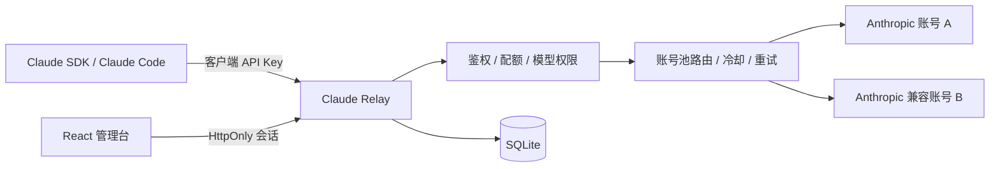

# Claude Relay

一个可自托管的 Anthropic Messages API 反向代理与运维控制台。它把多个 Anthropic 或 Anthropic 兼容账号汇聚为统一入口，提供账号池路由、客户端 API Key、配额、调用审计、Token/成本统计和一体化 Web 管理台。

生产镜像是单一 Go 进程：React 管理台在构建时嵌入二进制，SQLite 数据保存在一个持久卷中，不依赖额外数据库或 Redis。

> 本项目只代理你有权使用的上游账号。请遵守上游服务条款，不要共享、转售或绕过任何服务限制。

## 功能

- Anthropic 兼容端点：`POST /v1/messages`、`POST /v1/messages/count_tokens`、`GET /v1/models`
- SSE 流式响应原样透传，保留 `anthropic-beta`、`anthropic-version` 与上游限流头
- 多账号池：最久未使用、优先级、加权随机三种策略
- 429 / 5xx / 529 自动切换账号，指数冷却，401 凭证自动隔离
- 独立客户端 API Key：只保存哈希，可设置模型白名单、有效期和月度费用上限
- 管理台：运行概览、账号管理、用量趋势、调用日志、API Key、价格与系统设置
- 记录输入、输出、缓存 Token、TTFB、总耗时、状态码、上游账号和客户端 IP
- 上游 API Key 使用 AES-256-GCM 加密落盘；管理员密码使用 PBKDF2-SHA256
- 单 Docker 镜像、非 root 用户、只读根文件系统、内置健康检查

## 架构



## Docker 快速开始

1. 准备环境变量：

   ```bash
   cp .env.example .env
   ```

   至少修改 `.env` 中的 `ADMIN_PASSWORD`。生产环境还应设置一个 32 字节以上的随机 `MASTER_KEY`。

2. 构建并启动：

   ```bash
   docker compose up -d --build
   ```

   中国大陆网络可在 `.env` 中设置：

   ```dotenv
   GOPROXY=https://goproxy.cn,direct
   NPM_REGISTRY=https://registry.npmmirror.com
   ```

3. 打开 [http://localhost:8080](http://localhost:8080)，使用 `.env` 中的管理员用户名与密码登录。

4. 在「上游账号」中添加 Anthropic API Key并执行连接检测；再到「API Keys」创建客户端密钥。

如果设置了 `ANTHROPIC_API_KEY`，服务会在空数据库首次启动时自动导入一个默认上游账号。此变量在已有账号后不会覆盖数据库。

## 客户端接入

创建客户端 Key 后，把服务地址作为 Anthropic Base URL：

```bash
export ANTHROPIC_BASE_URL=http://localhost:8080
export ANTHROPIC_API_KEY=crp_live_xxxxxxxxxxxxxxxxx
```

Python SDK 示例：

```python
from anthropic import Anthropic

client = Anthropic(
    api_key="crp_live_xxxxxxxxxxxxxxxxx",
    base_url="http://localhost:8080",
)

message = client.messages.create(
    model="claude-sonnet-4-6",
    max_tokens=512,
    messages=[{"role": "user", "content": "你好"}],
)
print(message.content)
```

cURL 流式请求：

```bash
curl -N http://localhost:8080/v1/messages \
  -H 'content-type: application/json' \
  -H 'anthropic-version: 2023-06-01' \
  -H 'x-api-key: crp_live_xxxxxxxxxxxxxxxxx' \
  -d '{
    "model": "claude-sonnet-4-6",
    "max_tokens": 256,
    "stream": true,
    "messages": [{"role": "user", "content": "介绍一下你自己"}]
  }'
```

代理同时接受 `Authorization: Bearer <client-key>`，便于接入只支持 Bearer Token 的客户端。

## 上游账号与路由

每个账号可以配置：

- 独立 Base URL，默认 `https://api.anthropic.com`
- 模型规则，支持精确模型名和 `claude-sonnet-*` 形式的前缀
- 月度费用上限、优先级、加权路由权重
- 手动启停、连接检测和健康状态重置

可选路由策略：

| 策略 | 行为 |
| --- | --- |
| 最久未使用 | 优先选择当前在途请求更少、最近最少使用的账号；默认策略 |
| 优先级 | 先按优先级，再按在途请求和最近使用时间选择 |
| 加权随机 | 按账号权重和优先级随机分配，同时降低繁忙账号的权重 |

发生网络错误、429、500、502、503、504 或 529 时，网关会在响应客户端前切换另一个候选账号；`Retry-After` 会用于账号冷却。401 会把对应上游标为禁用，更新凭证或手动重置后才能重新进入池中。

## API 与鉴权

| 路径 | 鉴权 | 说明 |
| --- | --- | --- |
| `POST /v1/messages` | 客户端 API Key | Messages API，流式与非流式 |
| `POST /v1/messages/count_tokens` | 客户端 API Key | Token 计数透传 |
| `GET /v1/models` | 客户端 API Key | 模型列表；按 Key 权限过滤 |
| `/api/*` | 管理员 HttpOnly Cookie | 管理台 JSON API |
| `GET /healthz` | 无 | 容器和负载均衡健康检查 |

管理 API 使用 `SameSite=Strict` Cookie，并校验浏览器 `Origin`。代理 API 允许 CORS，适合 SDK 或受控的浏览器客户端调用。

## 配置

| 环境变量 | 默认值 | 说明 |
| --- | --- | --- |
| `LISTEN_ADDR` | `:8080` | HTTP 监听地址 |
| `DATA_DIR` | `./data` | SQLite 与自动生成主密钥目录 |
| `ADMIN_USERNAME` | `admin` | 仅首次创建数据库时使用 |
| `ADMIN_PASSWORD` | `change-this-password` | 仅首次创建数据库时使用，务必修改 |
| `MASTER_KEY` | 自动生成 | 加密上游凭证；生产环境建议显式固定 |
| `COOKIE_SECURE` | `false` | HTTPS 部署时设置为 `true` |
| `TRUSTED_PROXIES` | 空 | 可信反向代理 IP/CIDR，逗号分隔 |
| `MAX_REQUEST_BODY_MB` | `32` | 代理请求体上限，范围 1–256 MiB |
| `ANTHROPIC_API_KEY` | 空 | 首次启动可选导入的上游密钥 |
| `ANTHROPIC_BASE_URL` | `https://api.anthropic.com` | 首次导入账号的 Base URL |

超时、重试次数、路由策略、冷却、会话时长和日志保留期可在管理台热更新。

## 本地开发

要求 Go 1.24+、Node.js 20+ 与 npm。

```bash
npm --prefix frontend install

# 终端 1：后端
make dev-backend

# 终端 2：Vite 开发服务器（自动代理 /api 与 /v1）
make dev-frontend
```

构建一体化本地二进制：

```bash
make build VERSION=local
./bin/claude-relay
```

验证：

```bash
make test
make vet
```

## 数据与备份

Docker 数据位于 `claude-relay-data` 卷。至少备份：

- `claude-relay.db`、`claude-relay.db-wal`、`claude-relay.db-shm`
- `master.key`（如果未通过 `MASTER_KEY` 提供）

丢失 `master.key` 或改变 `MASTER_KEY` 后，已有上游 API Key 无法解密。备份 SQLite 时建议先停止容器，或使用 SQLite 在线备份工具，避免只复制主数据库却遗漏 WAL。

## 生产安全建议

- 使用 Caddy/Nginx/负载均衡器提供 HTTPS，并设置 `COOKIE_SECURE=true`
- 限制管理台访问来源；不要把初始管理员密码保留为默认值
- 把 `.env` 排除在版本控制外，并通过 secret manager 注入 `MASTER_KEY`
- 仅配置你有权使用的上游凭证；客户端 Key 按应用分发并设置配额
- 费用为本地估算值。模型价格发生变化时，在「系统设置 → 模型计价」中更新
- 调用日志默认不保存提示词或响应正文，避免业务内容进入审计库

示例 HTTPS 配置见 [`deploy/Caddyfile.example`](deploy/Caddyfile.example)。

## 项目结构

```text
cmd/server/             服务入口与后台维护任务
internal/httpapi/       管理 API、认证、路由和 Anthropic 代理
internal/store/         SQLite 数据层、统计和计价
internal/cryptox/       密钥加密、密码哈希与随机令牌
internal/web/           构建后嵌入 Go 二进制的前端资源
frontend/               React + TypeScript + Vite 管理台
deploy/                 部署示例
```

## 参考

功能规划参考了 [workbuddy2api](https://github.com/xiaofan6ya/workbuddy2api) 的多账号、配额与用量设计，以及 [workbuddy2api-panel](https://github.com/linguo2625469/workbuddy2api-panel) 的账号池可视化与冷却思路。本项目是独立实现，目标上游是公开的 Anthropic Messages API 或兼容服务，不包含 WorkBuddy/CodeBuddy 私有协议、登录逆向或任务自动化逻辑。
